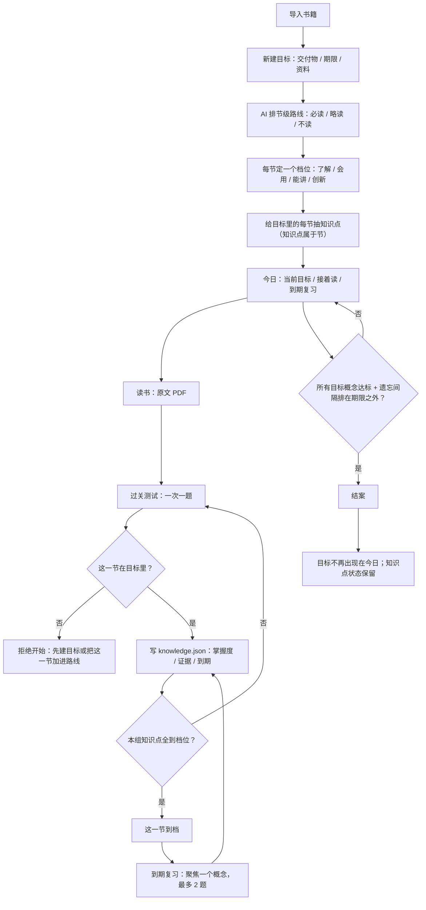
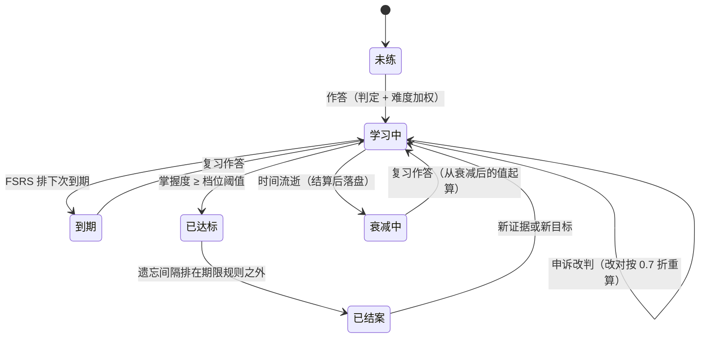

# dsh-study-less（书桌）

> 大部分读书工具都在催你读完，这个不是。
> 写下一个目标（比如：能独立推导这篇边缘计算论文），它把书裁成一条能读完的边界，剩下的明确标为不需要。
> 你每把一个知识点练到档位，它记一笔；全部到档位、复习也排到期限之外，就结案。
> 不依赖 AI，本地文件，随时导出。

**完整定位见 [docs/POSITIONING.md](docs/POSITIONING.md)——它是本仓库的规范文件，加功能前先读第八节「不做什么」。**
**面向读者的文字怎么说话，见 [docs/VOICE.md](docs/VOICE.md)。**
**改代码前先读 [AGENTS.md](AGENTS.md)——工程地图、改动导航、验证矩阵与阅读预算。**

## 主链路（知识点空间）

当前主回路围绕「知识点」组织：目标决定**学哪些节**和**每个点学到什么程度**，读书与做题只负责更新知识点状态，复习按到期把状态拉回来，全部达标且不再需要复习时结案。





**掌握度怎么变**（每个知识点各算，AI 只给 pass / partial / fail，数值由规则算）：

| 事件 | 掌握度 | 下次复习 |
|---|---|---|
| 答对新题 | 加 `学习率 ×（1 − 现值）`，学习率 0.14 / 0.18 / 0.22（简 / 中 / 难） | 按 FSRS 拉长 |
| 半对 | 学习率减半 | 小幅拉长 |
| 答错 | 现值 × 0.90 | 压到明天 |
| 申诉改判 | 换掉那条证据重算；改对的涨幅按 0.7 折计入 | 按改判后排程 |
| 时间流逝 | 每 45 天向「历史峰值的一半」衰减一半差距，结算后写回账本 | 未到档位的点最长隔 7 天 |
| 自评、勾「这节读完了」 | 不计 | — |

一路答对中等难度的新题：4 道到会用、7 道到能讲、12 道到创新。同一个知识点不会被同一道题考第二次。

四个状态源，各管一件事：

- `plans/<pid>.json`：节级路线（coverage）、每节的档位、交付物与期限。目标不列知识点。
- `knowledge.json`：每个概念的掌握度、证据（按「知识点 × 题干」排重）、FSRS 到期、结案标记。掌握度只有这一本账。
- `quiz-sessions/<sid>.json`：单次练习/复习的运行状态，不是进度。
- `concepts/<cid>.json` 与节上的 `meta.json.concepts`：知识点本体与出现位置；给一节补了知识点，引用它的目标立刻能看到。

**通过和评级分开**：通过只看「目标内知识点是否都到档位」；这是 `knowledge.json` 的确定性判断，模型只判每道答案，不再另设组级研判。题量、难度和证据数只影响下一次复习的间隔，不再当门槛。一组题用完而还有知识点没到档，就如实报告缺口，下一组继续。

## 当前实现状态

这个仓库目前是 **知识点空间 MVP（v0.8）**：核心回路是目标（节级路线 + 知识点档位 + 期限）→ 读书做题写知识点状态 → 到期复习 → 结案；通过只看知识点是否到档位，题量与评级不再设门槛。原文面仍是**原文件 PDF**（Range 流式，浏览器自带预览器），从「今天」进来会带目标上下文。判定题结案门与判定卡已删除；按节 FSRS 只作为旧账留在 `progress.json`。

上面那张「掌握度怎么变」已经落地（v0.8）：作答、申诉、`/quiz/submit` 都只写 `knowledge.json`；掌握度按证据时间序重算，闲置衰减在写路径结算；同一道题只算一条证据，出题侧直接排重；申诉改判会重算并打 0.7 折；档位与期限在写证据时传进去，不落进账本；结案门改用未截断的遗忘间隔；知识点清单只在节上，目标只声明每节到哪一档。

功能按新定位归位（「实验」= 默认不进主回路）：

| 功能 | 状态 | 与新定位的关系 |
|---|---|---|
| 导入 PDF、按目录切范围、原文件 PDF 阅读 | 保留 | 对应回路第 2 步「划边界」的素材；原文就是原 PDF，不再显示抽取文本 |
| 阅读面：语义块 + 引导卡 | 阶段一已实现 | 连续滚动原文，可全屏（全屏只留目录 / 过关测试 / 退出）；引导是右下角一只**小鲸鱼**（点开才展开成半透明云朵卡、可拖动、可收起，点开时先「想一想」再说话；块与块之间换颜色），按**语义块**换卡，任何一段都能点（当前块带底色，其余 hover 才亮），点开就那一段提问，也能一键复制；块按**段落**切，可在一页中间开始；这一面**不记账**（不统计时长、已读段、块内计数） |
| 目标 / 节级路线 / 结案（旧称「学习之路」） | 知识点空间已实现 | 交付物 + **必填期限** + 受众 → 必读·略读·不读（不读要理由）→ 每节一个档位（了解/会用/能讲/创新）→ 读书做题写知识点状态 → **全部到档位且复习排在期限外**才结案；路线与知识点可在文字/图形之间切换 |
| FSRS 复习 | 已改粒度 | 到期按知识点排程（`knowledge.json`）；按节到期单元只作为旧账留在 `progress.json` |
| 写好的导读（旧称「精读稿」） | 实验 | 属于「替你读」那一层；入口在阅读页「⋯」里的「导读（实验）」，主流程不再默认生成 |
| 自编书、洞察卡 | 已冻结 | 导航隐藏，默认不进主回路；代码保留，等主链路稳定后再决定去留 |
| 概念图 | 已冻结 | 从导读登记的概念，未与摘录打通；`/concepts`、`/concept` 返回 404 |

## 两个入口 + 一个设置

- **书架**（旧名「变强清单」）：书/论文的统一清单，导入后按目录切成节；点开是原文阅读器。
- **阅读**（旧名「学习之路」）：今日（当前目标 / 接着读 / 到期复习 / 低于档位）、目标详情（路线、知识点档位、结案条件；每块可切换文字/图形）。
- **设置**：引擎与外观，不算一个学习入口。
- 笔记（实验）与自编书已从导航隐藏，不在主回路。

## 数据布局

默认根目录 `$DSH_HOME/study`（可用插件配置 `dataRoot` 覆盖）：

```
library root/
├─ materials/<mid>/        # manifest.json / pages / source / layout / units/<uid>/{notes.md,meta.json,quiz.json,blocks.json,extras}
├─ concepts/<cid>.json     # 全局概念，跨资料共享
├─ plans/<pid>.json        # 目标、节级路线（每节含档位）、交付物与期限
├─ books/<bid>/            # 自编书：book.json + chapters/*.md + 章节练习 + book.md
├─ quiz-sessions/<sid>.json # 自适应练习会话
├─ knowledge.json          # 知识点空间：掌握度 / 证据 / 到期 / 结案
├─ progress.json           # 旧进度：阅读与按节 FSRS（概念账只在 knowledge.json 缺失时被一次性迁移读取）
├─ insights/<iid>.json     # 洞察卡
├─ jobs/<jobId>.json       # 页面内生成任务
├─ settings.json           # 引擎、学习偏好与单价（0600）
├─ usage.json              # 页面内 AI 调用：token / 费用聚合（总计 + 今天 + 每天）
└─ index/                  # 嵌入索引预留目录
```

## 页面内生成（实验）

设置（齿轮）里的四类能力：

| 能力 | 默认 | 说明 |
|---|---|---|
| 文本 | 复用 DSH 已配置模型（`ctx.llm` + `agentDefaultModel`） | 路径、导读、练习、洞察、校验；也可切到自定义 OpenAI 兼容接口 |
| 图片 | 关闭 | OpenAI Images 兼容，后续阶段接入 |
| 动画 | 关闭 | 先做文生 SVG/HTML，视频 API 预留 |
| 嵌入 | 关闭 | 语义检索/相关推荐，不是导入加速 |

练习使用 `quiz-sessions` 单题会话；单元题库不要求先写导读：没有导读时按原文出题。没有题库时现场出 1 题开局，题库不够覆盖待过知识点时在**下一组开始前**再补 1–3 题（不在判分请求里补，答题不会等出题）——**补出来的题只考这个知识点没见过的题**：同一个知识点不会被同一道题考第二次，过关测试和到期复习都遵守这条。同一节默认续答（`/quiz/session/start` 带 `restart: true` 才重开），完成记录保留 90 天。书籍章节练习存在 `books/<bid>/chapters/<cid>.quiz.json`。主观题（`recall`/`apply`/`evidence`）有文本引擎时由模型判分，判的是**答案对不对**，不是和参考步骤像不像：评分要点只用来判断「交代完整了没有」，换一种解法、换一套记号、换个顺序都算通过，数学题的换元/构造/从结论反推只要每步成立就判过；只有结论错、自相矛盾，或方向对但漏掉题干明确要求的条件与依据，才降到 partial / fail。判错可走 `/quiz/session/appeal` 提交 rebuttal，模型会结合原答案与 rebuttal 重新判定（补上推导或说明自己用的是另一条成立的路都算数），可多次申诉，最后一次为准；**改判会重算这个知识点的掌握度**（改对的涨幅按 0.7 折计入，改错正常扣）；直接抄评分要点或解析的 rebuttal 会被拒绝。没有引擎时才退回自评，自评只留在历史里、不计掌握度。

结构化调用（出题、判分、抽概念）把输出预算抬到 6144；模型把预算烧在思考上、返回空正文或撞上限时，会自动重跑一次（预算提到 8192–16384），而不是让整条生成失败。**思考强度不改**——它属于模型选择本身，DSH 会拒绝给不支持档位的模型（很多第三方 API）传这个字段。

从目标里打开的「过关测试」按这一节的概念考，只考还没到档位阈值的；作答写入 `knowledge.json`（掌握度、证据、FSRS 到期，算法见上面那张表）。**一组题只在所有目标点都到档时才关成「通过」**；题量用完、主动结束或被替换都只算「这一组结束」，并给出到档 X/Y 与还差哪几个。档位**不写进账本**：账本只存能力值，档位与期限在写证据时由会话快照传进去（`targetThresholds` / `horizonDays`），读侧由今日与结案门按当前目标算。练习只在目标内开放：目标覆盖但节上还没有知识点时，会先抽一次，抽不出来就明确拒绝并提示去补知识点；没有目标或这一节不在目标里时，练习页直接说明原因，不提供「出了题但不写进度」的退化模式。

## 主要 API

所有接口在 `/study-api` 下，仅接受本机回环且同源：

- 读：`/library`、`/material`、`/unit`、`/pdf`、`/today`、`/plans`、`/plan`、`/quiz`、`/quiz/sessions`、`/quiz/session`、`/jobs`、`/settings`、`/usage`；`/due` 属于旧账（按节 FSRS）
- 写：`/import/url`、`/unit/complete`、`/unit/uncomplete`、`/plan/update`、`/plan/close`、`/plan/concepts`（给一节补知识点）、`/goal/create`、`/plan/create`、`/plan/delete`、`/plan/retry-chat`、`/material/archive`、`/material/delete`；`/review`、`/quiz/submit` 只服务旧账
- 生成：`/generate/plan|unit|quiz|blocks`、`/generate/plan/retry`、`/jobs/:id/cancel`、`/settings/test`、`/plugin/restart`
- 阅读面：`/layout`（段落几何，按页缓存到 `materials/<mid>/layout/`）、`/ask`（小窗答疑，答完即走、不落库）、`/blocks/merge`（把一块并入上一块；不提供拆分或编辑器）
- 练习：`/quiz/session/start|answer|appeal|finish|reference`（`start` 默认续答，`restart: true` 重开；传 `concept` 进入该知识点的到期复习；`reference` 取这一题的原文片段；`appeal` 需要 `reason`，可选 `claim` 作为读者主张，最终由 AI 重判）
- 冻结：`/concepts`、`/concept`、`/insights`、`/insight/*`、`/books`、`/book/*`、`/generate/insight`、`/generate/book/*` 返回 404；代码保留，等主链路稳定后再删。
- 资产：`/asset?mid&uid&name`（HTML/SVG 带 sandbox CSP）

Agent 工具与 HTTP 共用同一 service 方法：`study_generate`（`plan|concepts|unit|quiz`）、`study_jobs`、`study_delete`、`study_quiz`。洞察/自编书工具与 HTTP 路由已冻结，不再注册。

## 开发

```bash
npm run build        # = node scripts/build.mjs：用 vendor 的 esbuild 打包 Host 与 Client
npm test             # = node --test tests/*.test.ts：纯逻辑单测
npm run check        # 全量闸门：构建 + 11 项 service / http / ui 检查
npm run typecheck    # tsc --noEmit；需要先 npm install（typescript / marked / katex）
node scripts/checks/service/check-plan.mjs   # 单项检查（部分依赖先生成临时库，见 AGENTS.md）
node scripts/checks/adhoc/check-pdf.mjs      # 一次性排查，不进闸门
node scripts/build-mascot.mjs                # 从 figure/ 的圆形头像重建大肥鱼（写 src/client/mascot.ts）
```

检查脚本按用途分在 `scripts/checks/`：`service/`（服务层端到端，stub 引擎）、`http/`（路由契约）、`ui/`（构建产物、Markdown、文案口径）、`adhoc/`（样本排查）。临时库统一落在 `.tmp/checks/`（git 忽略），`npm run check` 成功后会清掉。

构建产物在 `lib/`（git 忽略）。插件通过 profile 的 `link:` 安装，改完 Host 后需要重载插件或重启 Host；Client 改动重新 build 后刷新页面。
