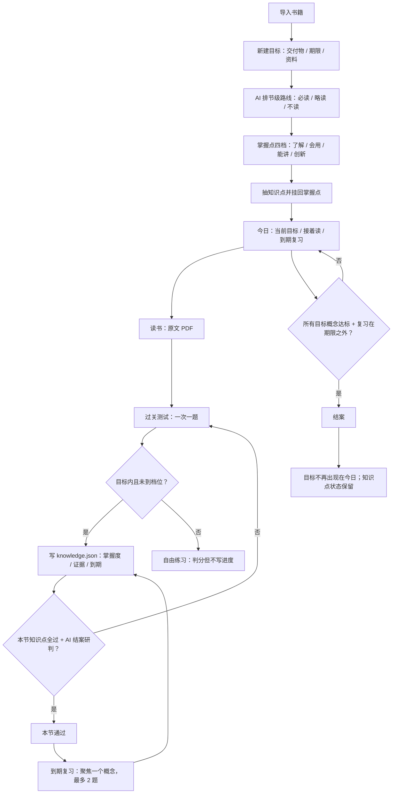
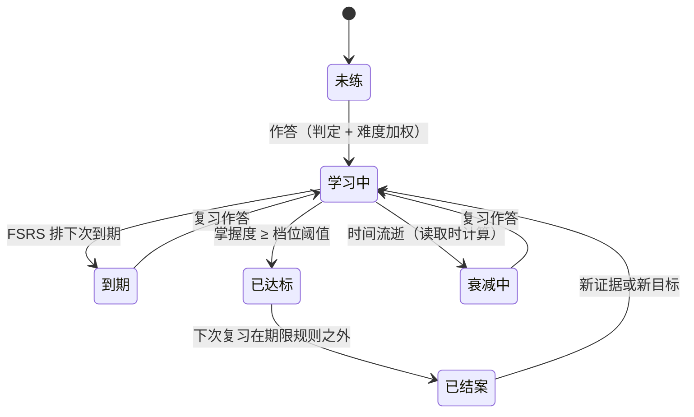

# dsh-study-less（书桌）

> 大部分读书工具都在催你读完，这个不是。
> 写下一个目标（比如：能独立推导这篇边缘计算论文），它把书裁成一条能读完的边界，剩下的明确标为不需要。
> 你每次独立做出一点小改动，它记一笔；卡在哪，也记一笔。够了就结案。
> 不依赖 AI，本地文件，随时导出。

**完整定位见 [docs/POSITIONING.md](docs/POSITIONING.md)——它是本仓库的规范文件，加功能前先读第八节「不做什么」。**
**面向读者的文字怎么说话，见 [docs/VOICE.md](docs/VOICE.md)。**
**改代码前先读 [AGENTS.md](AGENTS.md)——工程地图、改动导航、验证矩阵与阅读预算。**

## 主链路（知识点空间）

当前主回路围绕「知识点」组织：目标决定**学哪些节**和**每个点学到什么程度**，读书与做题只负责更新知识点状态，复习按到期把状态拉回来，全部达标且不再需要复习时结案。





四个状态源，各管一件事：

- `plans/<pid>.json`：节级路线（coverage）、掌握点与档位、交付物与期限。
- `knowledge.json`：每个概念的掌握度、去重证据、FSRS 到期、结案标记。
- `quiz-sessions/<sid>.json`：单次练习/复习的运行状态，不是进度。
- `concepts/` 与单元 meta：知识点本体与出现位置。

**通过和评级分开**：通过只看「目标内知识点是否都到档位 + AI 结案研判」；题量、难度和证据数只影响下一次复习的间隔，不再当门槛。

## 当前实现状态

这个仓库目前是 **知识点空间 MVP（v0.7 开发中）**：核心回路是目标（节级路线 + 知识点档位 + 期限）→ 读书做题写知识点状态 → 到期复习 → 结案；通过只看知识点是否到档位，题量与评级不再设门槛。原文面仍是**原文件 PDF**（Range 流式，浏览器自带预览器），从「今天」进来会带目标上下文。旧的判定题结案门、判定卡与按节 FSRS 属于兼容层，默认不在主回路。

功能按新定位归位（「实验」= 默认不进主回路）：

| 功能 | 状态 | 与新定位的关系 |
|---|---|---|
| 导入 PDF、按目录切范围、原文件 PDF 阅读 | 保留 | 对应回路第 2 步「划边界」的素材；原文就是原 PDF，不再显示抽取文本 |
| 阅读面：语义块 + 引导卡 | 阶段一已实现 | 连续滚动原文，可全屏（全屏只留目录 / 过关测试 / 退出）；引导是右下角一只**小鲸鱼**（点开才展开成半透明云朵卡、可拖动、可收起，点开时先「想一想」再说话；块与块之间换颜色），按**语义块**换卡，任何一段都能点（当前块带底色，其余 hover 才亮），点开就那一段提问，也能一键复制；块按**段落**切，可在一页中间开始；这一面**不记账**（不统计时长、已读段、块内计数） |
| 目标 / 节级路线 / 结案（旧称「学习之路」） | 知识点空间已实现 | 交付物 + **必填期限** + 受众 → 必读·略读·不读（不读要理由）→ 每节知识点四档（了解/会用/能讲/创新）→ 读书做题写知识点状态 → **全部到档位且复习排在期限外**才结案 |
| FSRS 复习 | 已改粒度 | 到期按知识点排程（`knowledge.json`）；判定卡与按节到期单元作为旧账保留，不在主回路 |
| 写好的导读（旧称「精读稿」） | 实验 | 属于「替你读」那一层；入口在阅读页「⋯」里的「导读（实验）」，主流程不再默认生成 |
| 自编书、洞察卡 | 已冻结 | 导航隐藏，默认不进主回路；代码保留，等主链路稳定后再决定去留 |
| 概念图 | 实验 | 从导读登记的概念，未与摘录打通 |

## 两个入口 + 一个设置

- **书架**（旧名「变强清单」）：书/论文的统一清单，导入后按目录切成节；点开是原文阅读器。
- **阅读**（旧名「学习之路」）：今日（当前目标 / 接着读 / 到期复习 / 低于档位）、目标详情（路线、知识点档位、结案条件）。
- **设置**：引擎与外观，不算一个学习入口。
- 笔记（实验）与自编书已从导航隐藏，不在主回路。

## 数据布局

默认根目录 `$DSH_HOME/study`（可用插件配置 `dataRoot` 覆盖）：

```
library root/
├─ materials/<mid>/        # manifest.json / pages / source / layout / units/<uid>/{notes.md,meta.json,quiz.json,blocks.json,extras}
├─ concepts/<cid>.json     # 全局概念，跨资料共享
├─ plans/<pid>.json        # 目标、节级路线、掌握点与档位
├─ books/<bid>/            # 自编书：book.json + chapters/*.md + 章节练习 + book.md
├─ cards/<cid>.json        # 最小复习卡（判定题答错生成，结案归档）
├─ quiz-sessions/<sid>.json # 自适应练习会话
├─ knowledge.json          # 知识点空间：掌握度 / 证据 / 到期 / 结案
├─ progress.json           # 旧进度：阅读与单元 FSRS（知识点状态已迁到 knowledge.json）
├─ insights/<iid>.json     # 洞察卡
├─ jobs/<jobId>.json       # 页面内生成任务
├─ settings.json           # 引擎与学习偏好（0600）
└─ index/                  # 嵌入索引预留目录
```

## 页面内生成（实验）

设置（齿轮）里的四类能力：

| 能力 | 默认 | 说明 |
|---|---|---|
| 文本 | 复用 DSH 已配置模型（`ctx.llm` + `agentDefaultModel`） | 路径、导读、练习、洞察、校验；也可切到自定义 OpenAI 兼容接口 |
| 图片 | 关闭 | OpenAI Images 兼容，后续阶段接入 |
| 动画 | 关闭 | 先做文生 SVG/HTML，视频 API 预留 |
| 嵌入 | 关闭 | 语义检索/相关推荐，不是导入加速 |

练习使用 `quiz-sessions` 单题会话；单元题库不要求先写导读：没有导读时按原文出题。没有题库时现场出 1 题开局，题库不够覆盖待过知识点时再补 1–3 题。同一节默认续答（`/quiz/session/start` 带 `restart: true` 才重开），完成记录保留 90 天。书籍章节练习存在 `books/<bid>/chapters/<cid>.quiz.json`。主观题（`recall`/`apply`/`evidence`）有文本引擎时由模型按评分要点判分；判错可走 `/quiz/session/appeal` 提交 rebuttal，模型会结合原答案与 rebuttal 重新判定，可多次申诉，最后一次为准；直接抄评分要点或解析的 rebuttal 会被拒绝。没有引擎时才退回自评。

从目标里打开的「过关测试」按目标的知识点走：目标规划时 AI 同时给出节级路线和每节要掌握的维度（`plans/<pid>.json` 的 `mastery`，带 1–4 档）；练习只考目标内、且还没到档位阈值的概念，作答写入 `knowledge.json`（掌握度、去重证据、FSRS 到期）。目标外的节或无目标时进入自由练习，只出题判分，不写任何进度。同一道题重复作答只算复习，不再叠加证据。

任务生命周期：`queued → running → done/failed/cancelled`。同 kind + target 去重；Host 重启后未完成任务标记为中断。浏览器轮询 `GET /study-api/jobs/:id`。

没有可用文本引擎时，新建目标会回退到「复制 prompt / 打开对话」，不会把创建目标卡死。

## 主要 API

所有接口在 `/study-api` 下，仅接受本机回环且同源：

- 读：`/library`、`/material`、`/unit`、`/pdf`、`/today`、`/concepts`、`/concept`、`/plans`、`/plan`、`/quiz`、`/quiz/sessions`、`/quiz/session`、`/jobs`、`/settings`；`/cards`、`/due`、`/insights`、`/books` 属于旧兼容或已冻结入口
- 写：`/unit/complete`、`/unit/uncomplete`、`/plan/update`、`/plan/close`、`/goal/create`、`/plan/create`、`/plan/delete`、`/material/archive`、`/material/delete`；`/review`、`/card/review`、`/plan/questions`、`/plan/judge`、`/quiz/submit` 是旧兼容层
- 生成：`/generate/plan|unit|quiz|insight|blocks`、`/generate/book/outline|chapter|continuity`、`/jobs/:id/cancel`、`/settings/test`
- 阅读面：`/layout`（段落几何，按页缓存到 `materials/<mid>/layout/`）、`/ask`（小窗答疑，答完即走、不落库）、`/blocks/merge`（把一块并入上一块；不提供拆分或编辑器）
- 练习：`/quiz/session/start|answer|appeal|finish`（`start` 默认续答，`restart: true` 重开；传 `concept` 进入该知识点的到期复习；`appeal` 需要 `reason`，可选 `claim` 作为读者主张，最终由 AI 重判）
- 书：`/book/export`、`/book/progress`、`/book/delete`
- 资产：`/asset?mid&uid&name`（HTML/SVG 带 sandbox CSP）

Agent 工具与 HTTP 共用同一 service 方法：`study_generate`、`study_jobs`、`study_insight`、`study_delete`、`study_quiz`、`study_book`。

## 开发

```bash
npm run build        # = node scripts/build.mjs：用 vendor 的 esbuild 打包 Host 与 Client
npm test             # = node --test tests/*.test.ts：纯逻辑单测
npm run check        # 全量闸门：构建 + 13 项 service / http / ui 检查
node scripts/checks/service/check-plan.mjs   # 单项检查（部分依赖先生成临时库，见 AGENTS.md）
node scripts/checks/adhoc/check-pdf.mjs      # 一次性排查，不进闸门
node scripts/build-mascot.mjs                # 从 figure/ 的圆形头像重建大肥鱼（写 src/client/mascot.ts）
```

检查脚本按用途分在 `scripts/checks/`：`service/`（服务层端到端，stub 引擎）、`http/`（路由契约）、`ui/`（构建产物、Markdown、文案口径）、`adhoc/`（样本排查）。临时库统一落在 `.tmp/checks/`（git 忽略），`npm run check` 成功后会清掉。

构建产物在 `lib/`（git 忽略）。插件通过 profile 的 `link:` 安装，改完 Host 后需要重载插件或重启 Host；Client 改动重新 build 后刷新页面。
