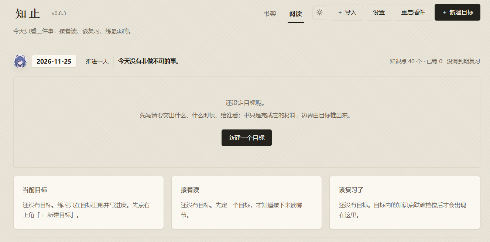
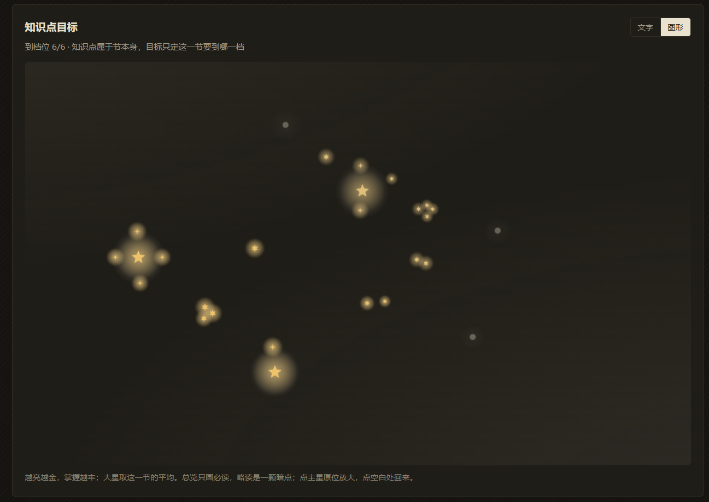

# 知止（dsh-study-less）

[](https://www.npmjs.com/package/dsh-study-less)
[](LICENSE)

> **study less, learn more.**

大部分读书工具都在催你读完，这个不是。写下一个目标（比如：能独立推导这篇论文），它把书裁成一条读得完的边界，剩下的明确标为**不需要读**。你每把一个知识点练到档位，它记一笔；全部到档、复习也排到期限之外，这个目标就结案。

两个入口：DSH 里的插件（侧栏「知止」），和不依赖 DSH 的独立网页版。数据都是本机文件。





## 安装

包在 npm 上：[dsh-study-less](https://www.npmjs.com/package/dsh-study-less)。

**插件版**（在 DSH 里用）：

```bash
dsh plugin --profile web add dsh-study-less
dsh --profile web          # 重启后侧栏出现「知止」
```

**独立网页版**（不用 DSH，只开一个本机页面）：

```bash
npx dsh-study-less         # → http://127.0.0.1:7801
```

只监听 `127.0.0.1`，数据默认在 `~/.zhizhi`（`STUDY_DATA_ROOT` 可改）。需要 Node 22+。

**从源码**：

```bash
git clone https://github.com/Bejohnself/dsh-study-less.git && cd dsh-study-less
npm install && npm run build && npm run build:web
npm run start:web          # 或 dsh --profile web 用插件版
```

## 5 分钟走一遍

1. **导入**：书架 → 导入 PDF。有书签目录的按目录切成节；没有的先用 [tocify](https://tocify.aeriszhu.com/) 补一份目录再导入。
2. **建目标**：写清交付物（「独立推导注意力机制」这种）、期限和受众。期限必填——没有期限就没有「什么时候可以不读」。
3. **排路线**：AI 给出必读 / 略读 / 不读，不读要写理由；不满意可以手改。
4. **定档位**：每节一个档位——了解 / 会用 / 能讲 / 创新。档位决定后面考到什么程度。
5. **读原文**：浏览器原生 PDF，可全屏。选中一段，右下角的小鲸鱼就这一段提问，不记账、不统计。
6. **过关测试**：一次一题。答对推进，答错退回更简单的题；同一道题不会考你第二次。
7. **今日**：到期的知识点进复习；所有目标知识点到档、且预计掉档日排在期限之后，就可以结案。

AI 只判「这个答案对不对」，掌握度数值由规则算，不看时长和题量。

## 掌握度怎么变

每个知识点各算一本账：

| 事件 | 掌握度 | 下次复习 |
|---|---|---|
| 答对新题 | 加 `学习率 ×（1 − 现值）`，学习率 0.14 / 0.18 / 0.22（简 / 中 / 难） | 衰减到档位下就再来 |
| 半对 | 学习率减半 | 同上，间隔更短 |
| 答错 | 现值 × 0.90 | 复习计数 `k` 减半，随后更快掉档 |
| 复习通过 | 至少加 0.05（高档位不会只剩一丝余量） | `k + 1`，半衰期 × 1.6 |
| 申诉改判 | 换掉那条证据重算；改对的涨幅按 0.7 折计入 | 按改判后的 `k` 重算 |
| 时间流逝 | 半衰期 7 天，向「历史峰值的一半」衰减；每多一天有效复习 × 1.6，封顶 365 天 | 跌破档位当天进「该复习了」 |

一路答对中等难度的新题：4 道到会用、7 道到能讲、12 道到创新。

## 它不做什么

- 不统计阅读时长，不打卡，不催进度。
- 不默认生成全文导读或总结（阅读页「⋯」里有个实验入口，默认不用）。
- 不联网就不同步：没有账号，没有云端，文件夹就是你的全部数据。
- 不替你挑书：读什么、读到什么程度，都由目标决定。

## 常见问题

**必须配 AI 吗？** 排路线、出题、判分要模型。只读原文、记笔记不需要。插件版可以勾「复用 DSH 模型」，网页版填一个 OpenAI 兼容接口的 Base URL、模型名和 Key。

**Key 存在哪？** 数据目录下的 `settings.json`，权限 0600，只在本机。

**数据在哪？怎么备份？** 插件在 `$DSH_HOME/study`，网页版在 `~/.zhizhi`。都是普通 JSON + 原 PDF，复制文件夹就是备份，删文件夹就是清空。

**插件版和网页版能共用数据吗？** 不能，两个目录是分开的；想搬就手动复制。

**能读 EPUB / Word 吗？** 目前只支持 PDF。

**支持 Windows / macOS 吗？** 插件跟着 DSH 装；网页版就是 Node 22+ 起的本机服务，哪个系统都能跑。

## 开发

```bash
npm test             # 162 项纯逻辑单测
npm run check        # 全量闸门：构建 + 11 项 service / http / ui 检查
npm run typecheck    # tsc --noEmit（先 npm install）
```

工程地图与改动导航见 [AGENTS.md](AGENTS.md)，产品规范与「不做什么」见 [DESIGN.md](DESIGN.md)，模块边界见 [ARCHITECTURE.md](ARCHITECTURE.md)，实现现状、数据布局与 API 见 [docs/IMPLEMENTATION.md](docs/IMPLEMENTATION.md)，发版流程见 [docs/RELEASING.md](docs/RELEASING.md)。

## 许可

MIT，见 [LICENSE](LICENSE)。随包分发的第三方运行时：pdf.js（Apache-2.0）、KaTeX（MIT）、marked（MIT），许可原文在 `vendor/*/LICENSE`。`tests/fixtures/attention.pdf` 是 arXiv 论文样张，只给检查脚本当输入，不进 npm 包。